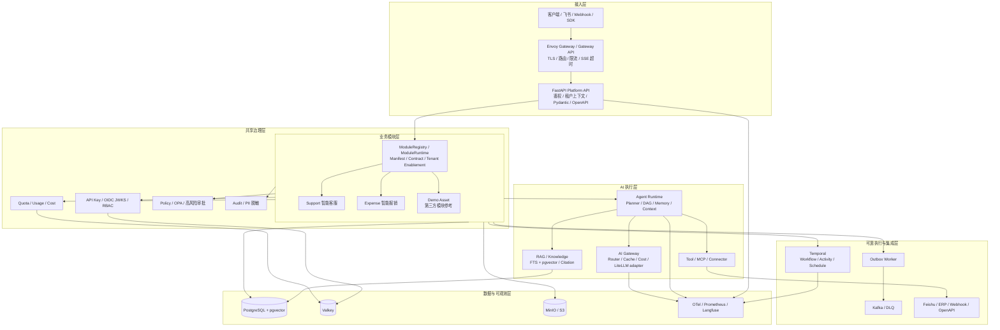
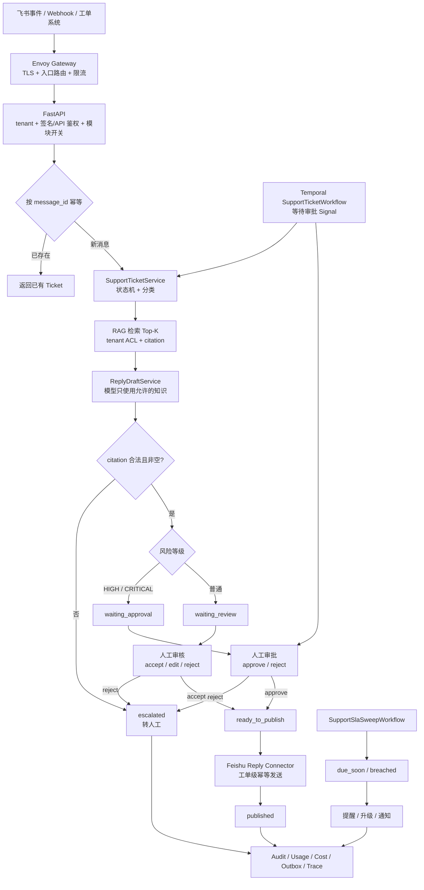
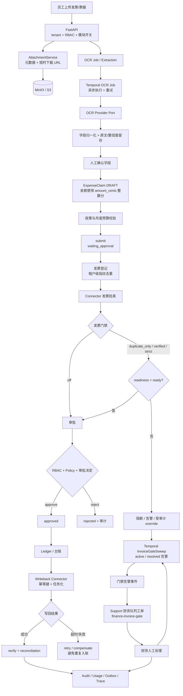
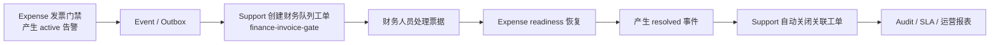

# AgentForge


> **让 AI 从 Demo 走进真实业务，而不是停在 Prompt 和演示里。**

AgentForge 是一个面向企业 AI 业务流的 **共享平台内核 + 可装配业务模块 + 多租户 SaaS/私有化交付** 框架。

它把模型接入、Agent 编排、RAG、权限策略、人工审批、审计、配额成本、可靠工作流和外部系统连接沉淀为统一底座。业务团队只实现领域模块，就能把客服、报销等 AI 场景做成可治理、可计量、可运营、可交付的产品。

当前版本为 `3.1.0`，完整业务线有两条：**Support 智能客服** 和 **Expense 智能报销**。`Demo Asset` 是第三方模块契约的参考实现，不计入第三条完整业务线。

---

## 项目价值

AgentForge 解决的不是“怎么调用一次大模型”，而是企业 AI 落地时必须同时解决的七类工程问题：

| 企业问题 | 常见 Demo 做法 | AgentForge 的做法 | 业务结果 |
|---|---|---|---|
| 多租户容易串数据 | 只在一个 Prompt 或一次请求里带 tenant | tenant 贯穿请求、仓储、RAG、Tool、缓存、审计和 Event | 租户边界可验证、可回归 |
| Agent 能“自行其是” | 模型返回工具名后直接执行 | 模型只提议，Runtime 做白名单、参数、权限、租户边界四道校验 | 模型不能越权产生副作用 |
| RAG 有答案却没有依据 | 只拼 Top-K 文本 | 文档版本、租户 ACL、页码、chunk_id、citation 回查 | 回答可追溯，降低旧知识和幻觉风险 |
| 审批等待时间很长 | 进程内 sleep 或临时状态 | Temporal 持久化 Workflow，支持 Signal、恢复、重试和 Schedule | 服务重启不丢流程 |
| 外部写回重复 | 超时后直接重试 HTTP | Outbox、幂等键、写回任务、验真、对账和补偿 | 最终一致，避免重复入账 |
| 成本不可解释 | 只看供应商月账单 | 按 tenant、task、model、Prompt、Token、Workflow、OCR 计量 | 能归因、能限额、能审计 |
| 每做一个场景就复制一套底座 | 每个业务重写鉴权、日志、状态机 | ModuleManifest、SDK Port、ModuleRegistry、双仓储和契约测试 | 新业务做插件，不修改平台内核 |

一句话概括：

> **共享内核负责治理，业务模块负责领域；模型只提议，平台负责权限、状态、副作用和审计。**

### 这个项目不做什么

- 它不是通用聊天 UI，也不绑定某一家模型供应商；
- 它不是只演示 Agent 调用的 PoC，核心价值在治理、可靠性和交付边界；
- 外部提供方未配置时，系统不会伪装成“已经生产接入”，而是保持可注入、可 Mock、可契约测试的状态；
- `Demo Asset` 只用于证明第三方模块可以按 SDK 接入，不代表第三条完整业务线。

---

## 整体架构



### 分层边界

| 层 | 当前主要实现 | 核心职责 |
|---|---|---|
| 接入层 | Envoy Gateway、Gateway API、HTTPRoute、RateLimitPolicy；保留 Ingress 兼容模式 | TLS、入口路由、基础限流、SSE 空闲/总时长边界和流量入口 |
| API/BFF | FastAPI、Pydantic v2、OpenAPI、平台中间件 | 鉴权、租户上下文、请求校验、模块路由和统一错误边界 |
| 业务模块 | Support、Expense；Demo Asset 为参考实现 | 领域状态机、业务规则、模块用例、Connector 和模块 Workflow |
| 平台内核 | ModuleRegistry、Policy、RBAC、Approval、Audit、Quota、Usage、Cost | 把权限、审计、计量和模块生命周期统一收口 |
| AI 执行 | Planner、DAG、Agent Runtime、Memory、ContextStore、Tool | 编排、上下文、工具边界、超时、降级和请求放大保护 |
| AI Gateway | SmartRouter、Semantic Cache、CostTracker、LiteLLM adapter | 模型选择、缓存、Fallback、Token 成本和供应商隔离 |
| 知识层 | FTS、pgvector、Hybrid Retrieval、Rerank、Citation Guard、Parser Port | 知识解析、切块、混合检索、引用回查和租户过滤 |
| 可靠执行 | Temporal、Outbox、Kafka、DLQ、Connector | 长流程恢复、重试、最终一致、写回、对账和补偿 |
| 数据与观测 | PostgreSQL、Valkey、MinIO/S3、OTel、Prometheus、Langfuse | 事实源、缓存、对象、链路、指标、Prompt 和评测数据 |

### 关键组件与当前状态

| 组件 | 代码中的当前形态 | 状态说明 |
|---|---|---|
| Envoy Gateway / Gateway API | Helm 中有 `Gateway`、`HTTPRoute`、`RateLimitPolicy`，CI 在 kind 中安装真实 controller 并做 server-side dry-run | 已接入代码与验证链路；默认关闭，按环境开启 |
| Nginx Ingress | Helm 保留 `ingress.yaml` 和 `edgeGateway.className` 兼容字段 | 兼容回退，不是主推入口 |
| FastAPI | 平台 API、模块 Router、认证中间件、限流中间件都在 FastAPI 中装配 | 已落地 |
| LiteLLM | `LiteLLMGateway` adapter 和 `gateway_factory`，可通过 `AGENTFORGE_AI_GATEWAY_BACKEND` 切换 | 已落地适配层；外部 Proxy 和真实模型凭证按环境提供 |
| OIDC / JWKS | JWKS 校验器、OIDC authenticator、JWT 签名/issuer/audience/过期时间和 claim 校验；本地提供 Keycloak Compose | 校验能力与测试已落地；`oidc` 模式需 composition root 显式注入 validator，默认仍走 API Key |
| OPA | `OPAPolicyAdapter`、Rego 策略资产、本地 Compose 和 adapter 测试 | adapter 与资产已落地；默认运行时仍使用本地 PolicyEngine，切换需显式装配和故障验证 |
| OpenFGA | `openfga_adapter.py` 提供关系权限适配边界 | 适配层已预留，不作为当前默认授权引擎 |
| Valkey 限流 | Memory / Valkey 两种后端，平台中间件可按配置启用 | 已落地；生产默认关闭，需显式开启 |
| Redis ContextStore | 租户、会话、DAG 命名空间、TTL、访问日志和工厂 | 实现与测试已落地；默认仍为 memory，Worker/DAG 需显式使用工厂接线 |
| Temporal | 模块 Task Queue、Support Workflow、SLA Sweep、OCR Job、Expense 门禁扫描、台账写回和通用 DAG Workflow | 模块 Workflow 已接线；通用 `TemporalDagWorkflow` 已有定义和测试，DAG executor 仍需显式选择 |
| Outbox / Kafka / DLQ | Outbox Store、Dispatcher、Worker、handler receipt、重试、重放和丢弃 | 已落地 |
| RAG 解析 | Docling 为可注入真实适配器；PaddleOCR、Unstructured、Tika 为适配边界 | 未在仓库内托管解析服务，真实服务需接入 |
| Prompt / Trace | Langfuse Prompt adapter、OTel GenAI 属性、本地 OTel Collector 资产 | adapter、属性和测试已落地；Langfuse 项目与 Prompt 读取需显式接线 |
| 评测 | Golden Set、promptfoo 配置、分类/检索评估和回归服务 | 已落地仓库资产；真实评测数据由业务补充 |

> 设计原则：能由成熟组件承担的通用能力优先组件化。自研集中在业务路由公式、模块契约、高风险审批、租户边界、引用回查、预算策略和财务门禁规则。

---

## 一次请求如何穿过整个系统

下面以 Support 的一条消息为例，把请求链路和关键面试知识点串起来：

```text
飞书/Webhook 消息
  -> Envoy Gateway
  -> FastAPI /v1/support/events/im 或 /v1/support/workflows/support
  -> 鉴权 + tenant + 模块开关 + 限流
  -> SupportTicketService / SupportTicketProcessingService
  -> 分类 + RAG + 模型草稿 + citation 校验
  -> 人工审核/审批
  -> Feishu Connector 发布
  -> Audit + Usage + Cost + Outbox
```

| 步骤 | 所在层 | 实际动作 | 关键边界 |
|---|---|---|---|
| 1 | 接入层 | Gateway 接收 HTTPS/Webhook，路由到 FastAPI Service | 入口只做通用能力，不承载业务规则 |
| 2 | API/BFF | 解析请求、校验 tenant、API Key/OIDC、模块是否启用 | `tenant_id` 不能从业务 body 任意推断 |
| 3 | 平台治理 | 限流、配额、RBAC、Policy 判断 | 高风险动作还要进入人工审批 |
| 4 | 模块层 | Support 用 `message_id` 做幂等，创建 Ticket 并进入状态机 | 重复消息不重复建单 |
| 5 | 分类/知识 | 规则分类器给出 intent、priority、team、risk；RAG 按 tenant 检索 Top-K | 检索结果只来自当前租户、当前权限范围 |
| 6 | AI Gateway | 只使用允许的知识生成草稿，记录模型、Token 和成本 | 模型只生成内容，不直接执行外部副作用 |
| 7 | 引用校验 | 返回的 citation 必须是本轮允许的 chunk_id | 无引用或非法引用转人工 |
| 8 | 人工环节 | reviewer accept/edit/reject；高风险 Ticket 进入 approval | 审核和审批不能互相冒充 |
| 9 | 外部写回 | Feishu Connector 使用工单级幂等键发送 | 超时不能盲目重复发送 |
| 10 | 可靠与审计 | 状态与 Outbox 事件在同一业务边界；Audit、Usage、Cost、Trace 按各自边界记录 | 事件不能因下游短暂不可用而丢失 |
| 11 | 长流程 | Temporal 持有等待审批的 Workflow，服务重启后继续 | Temporal 不负责业务规则和 Prompt |
| 12 | 运营闭环 | SLA Sweep 产生临期/逾期事件，通知或升级 | 告警、审计和业务状态可回查 |

**重点区分：**

- Gateway 解决南北向流量和入口策略，不替代业务鉴权；
- FastAPI 解决协议适配和用例入口，不替代模块领域逻辑；
- Temporal 解决持久化执行和恢复，不负责 DAG 规划；
- Planner/DAG 解决单次 AI 任务编排，不替代长流程 Workflow；
- AI Gateway 解决模型路由、成本和降级，不承担租户授权；
- RAG 解决知识检索，不承担“是否允许执行高风险动作”的决策。

---

## 业务线一：Support 智能客服

### 解决什么问题

- 客户消息来自飞书、Webhook 和工单系统，入口分散；
- 客服需要人工判断意图、风险、优先级和负责团队；
- 回复需要查知识，但答案必须能追溯到原文；
- 退款、补偿、投诉、隐私等高风险场景不能由模型直接对外回复；
- 审核、审批可能等待较久，进程重启不能丢状态；
- 重复消息、重复审核和重复发送需要幂等；
- SLA 到期需要提醒、升级和通知；
- 人工修改结果需要沉淀为评测样本，持续改进分类和生成。

### 详细业务流转图



### 每一步做什么

| 步骤 | 输入 | 处理 | 输出 |
|---|---|---|---|
| 入口 | 飞书事件、Webhook、tenant、消息体 | 签名/Token 校验、API 鉴权、模块开关校验 | 标准内部事件 |
| 幂等 | `tenant_id + message_id` | 仓储按幂等键查重 | 已有工单或新工单 |
| 分类 | 消息文本 | `RuleBasedTicketClassifier` 判断 intent、P0-P3、团队和风险 | 路由元数据 |
| 知识检索 | 工单主题、tenant | `KnowledgePort.search` 返回限定租户的 chunks | Top-K 证据 |
| 草稿生成 | 工单 + chunks | Prompt 明确只允许使用提供的上下文 | 回复草稿、模型信息、成本 |
| 引用校验 | 模型 citation 与允许 chunk_id | 无引用、越界引用直接失败 | 可人工处理的草稿或升级 |
| 审核 | 草稿、reviewer_id、动作 | accept/edit/reject，状态机校验 | `ready_to_publish` 或 `escalated` |
| 审批 | 高风险 Ticket、审批人 | Policy/RBAC + 人工审批 Signal | 审批决定和审计证据 |
| 发布 | 已审核文本、回复目标 | Connector 使用 `reply-{ticket_id}` 幂等发送 | `published` |
| SLA | open 状态工单、due_at | 周期扫描临期和逾期 | 提醒、升级、通知事件 |
| 沉淀 | 原始草稿、最终文本、审核原因 | 生成评测样本 | 可用于回归的样本 |

### 业务价值与可观测指标

- **缩短首次响应时间**：观察 `ticket.created -> reply.published` 的周期；
- **减少重复录入**：观察幂等命中率、人工复制粘贴动作；
- **降低不可信回复**：观察 citation 合法率、无知识转人工率；
- **控制高风险输出**：观察高风险工单审批覆盖率、审批拒绝率；
- **改善服务质量**：观察 accept/edit/reject 比例和 edit 距离；
- **提升 SLA 履约**：观察 due-soon、breached、escalated 数量；
- **持续优化模型**：人工修改样本可进入 Golden Set 和回归流程。

---

## 业务线二：Expense 智能报销

### 解决什么问题

- 发票、附件和报销字段人工录入慢，容易错；
- 金额、日期、币种、类别、发票号等字段需要归一化；
- 类别限额、月度预算和累计占用需要提前校验；
- 重复发票、金额不一致和发票验真失败难以及时发现；
- 审批通过不等于可以入账，还需要发票门禁和台账条件；
- ERP/财务系统写回可能出现超时、重复入账和状态不一致；
- 门禁异常需要形成财务待办，并与客服工单联动闭环；
- 报销周期、OCR 修正率、门禁命中率和写回成功率需要可观测。

### 详细业务流转图



### 每一步做什么

| 阶段 | 处理 | 关键实现 |
|---|---|---|
| 附件 | 单文件上传、分片上传会话、完成上传、短时下载 URL | `ExpenseAttachmentService`、对象存储 Port、MinIO/S3 |
| OCR | 单条提取、批量 OCR Job、状态查询、失败重试、导入批次 | `ExpenseOcrJobService`、`ExpenseExtractionService`、Temporal OCR Workflow |
| 字段确认 | 服务端保留 OCR 原文、置信度、人工修改字段 | 确认后创建草稿，避免覆盖原始证据 |
| 建单 | 申请、金额、币种、日期、类别、说明、附件、幂等键 | `ExpenseClaimService.create_claim` |
| 政策预算 | 类别限额、月度累计占用、违规信息写入上下文 | `ExpensePolicy`、`amount_cents` |
| 提交审批 | DRAFT -> WAITING_APPROVAL；同时评估发票 readiness | `submit_claim`、`InvoiceService.evaluate_claim` |
| 发票登记 | 租户级指纹去重、发票状态、验真 Connector | `InvoiceService.check_duplicates/register_for_claim/verify_invoice` |
| 门禁 | `off / duplicate_only / verified / strict` 四档策略 | 阻断、readiness、override、指标和告警 |
| 审批 | RBAC/Policy 通过后才允许 approve/reject | `decide_claim`、`PolicyPort`、`AuditPort` |
| 台账 | 只有 approved claim 进入台账和汇总 | `LedgerService.list_approved` |
| 写回 | 台账 -> ERP/财务 Connector；支持任务、验真、补偿和对账 | `LedgerService.writeback/verify/compensate/reconcile` |
| 告警闭环 | 门禁告警 active/resolved，重复扫描幂等 | `ExpenseInvoiceGateSweepWorkflow` |
| 跨模块协作 | 告警事件创建/关闭 Support 财务队列工单 | Expense 事件 + Support 财务队列和 SLA |

### 业务价值与可观测指标

- **降低录入成本**：OCR 自动提取率、人工确认耗时、字段修正率；
- **降低合规风险**：政策拦截率、预算超限率、重复发票阻断数；
- **缩短报销周期**：`claim.created -> approved -> written_back`；
- **提升财务准确性**：验真通过率、门禁阻断率、override 数量；
- **保证写回一致性**：写回成功率、重试次数、对账差异和补偿次数；
- **形成运营闭环**：活跃门禁告警、恢复告警、财务工单关闭率；
- **支持管理复盘**：按 tenant、类别、团队、月份统计金额和异常。

### 两条业务线如何闭环



这条链路体现的不是“两个模块放在同一个仓库”，而是 **领域职责分离、事件契约协作、人工审批兜底和跨模块审计闭环**。

---

## 模块化设计

每个业务模块遵循相同目录边界：

```text
agentforge/platform/modules/<module>/
├── api/                  # FastAPI Router，只调用本模块 application
├── application/          # 用例、业务规则、审计/Outbox 编排
├── domain/               # 领域模型、状态机、值对象
├── infrastructure/       # Memory/SQLAlchemy/S3/Connector 实现
├── workflows/            # Temporal Workflow 和 Activity
├── config.py             # 模块配置 schema
├── module.py             # ModuleManifest / ModuleRuntime 装配
├── ports.py              # 模块自有 Port
└── README.md             # 模块能力、接口与边界
```

核心约束：

1. 平台内核不 import Support、Expense 或第三方业务模块；
2. 模块 Application 只依赖本模块 Port 和 `agentforge.platform.sdk`；
3. `ModuleManifest` 声明名称、版本、API 前缀、Task Queue 和依赖；
4. `ModuleRegistry` 负责装配、契约校验和路由挂载；
5. 租户通过 `tenant_modules` 控制模块启停和配置；
6. 模块必须通过契约测试、租户隔离测试和迁移检查；
7. 业务模块可以使用共享数据库 Base 和 Outbox 模型，但不能反向依赖平台编排实现。

---

## 项目目录结构

```text
agentforge/
├── agents/                      # 内置工程型 Agent 示例
├── api/                         # 早期编排 API 兼容入口
├── cli/                         # agentforge 命令行入口
├── core/                        # Agent、Memory、Tool、Context、Event Bus
├── gateway/                     # 模型路由、复杂度、语义缓存、成本
├── llm/                         # LLM 访问抽象
├── observability/               # 日志、指标、Trace
├── orchestration/               # Planner、DAG、Loop、超时、降级、Temporal DAG
├── prompts/                     # Prompt 管理基础能力
├── rag/                         # 切块、混合检索、Rerank、引用守卫、解析适配
├── safety/                      # 信任边界、AIMD、脉冲整形、冲突仲裁
├── sdk/                         # 对外 SDK/builder/client
├── storage/                     # Redis 状态、任务和 Trace 存储
├── tools/                       # 代码审查、测试、文档、安全扫描等工具
├── workflow/                    # 编排工作流运行时
└── platform/
    ├── api/                     # FastAPI 平台 API、认证、限流、管理 Router
    ├── application/             # 租户、策略、知识、计量、评测、Prompt、发布
    ├── connectors/              # Connector 抽象和厂商适配
    ├── core/                    # 模块注册表、运行时契约
    ├── domain/                  # 平台领域模型
    ├── infrastructure/
    │   ├── auth/                # OIDC / JWKS
    │   ├── authz/               # OPA adapter
    │   ├── db/                  # SQLAlchemy Base、平台模型
    │   ├── llm/                 # LiteLLM / Static Gateway
    │   ├── prompt/              # Langfuse Prompt adapter
    │   └── temporal/            # Temporal Client
    ├── modules/
    │   ├── support/             # 智能客服完整业务模块
    │   ├── expense/             # 智能报销完整业务模块
    │   └── demo_asset/          # 第三方模块参考实现
    ├── observability/           # 平台 Trace/指标辅助
    ├── sdk/                     # ModuleManifest、Port、Connector、Upgrade Port
    ├── security/                # Secret、脱敏、生命周期
    ├── module_catalog.py        # 内置模块和插件装配
    ├── plugin_loader.py         # entry point 插件发现
    ├── runtime.py               # ServiceContainer 与 composition root
    └── settings.py              # AGENTFORGE_* 配置

alembic/                         # 数据库迁移
bench/                           # 负载与性能脚本
configs/                         # 配置样例
deploy/
├── helm/agentforge/             # API/Worker/Outbox/Migration/Gateway/HTTPRoute
├── local/
│   ├── docker-compose.integration.yml
│   ├── kind-envoy.yaml
│   ├── keycloak-compose.yml
│   ├── litellm/
│   ├── mock_openai/
│   └── observability/
└── platform/                    # 本地平台 Compose 与镜像配置

docs/                            # 架构、模块、基础设施、安全和 SaaS 文档
evals/                           # Golden Set 与 promptfoo 配置
examples/                        # 编排、事件总线和端到端示例
policies/                        # OPA Rego 策略资产
scripts/                         # 集成、发布、迁移、安全和门禁脚本
templates/module-template/       # 第三方模块模板
tests/
├── unit/                        # 单元测试
├── integration/                 # 真实容器/协议集成测试
├── platform/                    # 平台、模块和治理能力测试
└── infra/                       # PostgreSQL/Valkey/Temporal/MinIO 基础设施测试
```

---

## 部署形态与高可用边界

### 本地完整平台

```bash
docker compose -f deploy/platform/docker-compose.platform.yml up -d
```

主要包含 PostgreSQL、Valkey、Temporal、Temporal UI、MinIO、Kafka、OTel Collector、Migration Job、API、Temporal Worker 和 Outbox Worker。

### 本地接入集成环境

```bash
docker compose -f deploy/local/docker-compose.integration.yml up -d --build mock-openai opa valkey
python scripts/check_local_stack.py
AGENTFORGE_LOCAL_STACK=1 python -m pytest tests/integration -q
docker compose -f deploy/local/docker-compose.integration.yml down -v
```

该命令启动 Mock OpenAI、OPA 和 Valkey，用于本地 readiness 与服务集成检查；Security Integration、Observability Integration 和 OIDC/JWKS 测试由各自测试集和 GitHub Actions Job 验证。LiteLLM Proxy、真实模型供应商、MinIO、Temporal、真实 OCR 和真实 IdP 需要按目标环境显式启动和配置，不能把 adapter 存在等同于生产供应商已接入。

### kind + Envoy Gateway

```bash
kind create cluster --config deploy/local/kind-envoy.yaml
helm install eg oci://docker.io/envoyproxy/gateway-helm \
  --version v1.2.0 \
  -n envoy-gateway-system \
  --create-namespace
helm template agentforge deploy/helm/agentforge \
  --set edgeGateway.enabled=true > /tmp/agentforge.yaml
kubectl apply --dry-run=server -f /tmp/agentforge.yaml
```

Helm 默认值保持兼容：`edgeGateway.enabled=false`、`ingress.enabled=false`。私有化环境按实际入口能力选择 Gateway API 或 Ingress。

### Helm 交付拓扑

- API Deployment：无状态、可水平扩容，默认 2 副本；
- Temporal Worker Deployment：按模块 Task Queue 执行 Workflow/Activity；
- Outbox Worker Deployment：发布事件、维护 receipt、重试和 DLQ；
- Migration Job：pre-install/pre-upgrade 执行 Alembic；
- Service、Gateway、HTTPRoute、RateLimitPolicy、Ingress 兼容模板；
- ServiceAccount、ConfigMap、existing Secret；
- 容器默认非 root、只读根文件系统、禁止权限提升、丢弃 Linux capabilities。

### 商业基线与生产边界

本仓库提供可验证的商业基线、集成资产和部署模板，**不承诺生产 HA**、备份恢复、灾备切换和客户验收结果；这些能力必须在目标环境中结合真实容量、SLA 和运维体系验收。

- PostgreSQL、Temporal、Kafka、Valkey、MinIO/S3 由目标环境提供，不在 Helm 内托管有状态集群；
- Compose 是开发、演示和集成环境，不是生产高可用方案；
- API/Worker/Outbox 可以横向扩展，但最终容量瓶颈仍取决于 PG、Temporal 和消息系统的真实容量规划；
- 企业 IdP、KMS/Vault、WAF、证书、域名、备份恢复、灾备和客户验收必须按目标环境完成；
- 真实 OCR/解析服务、真实模型供应商和真实 ERP/财务系统需要通过 Connector 配置和 smoke test 验证。

---

## 快速开始

### 安装依赖

```bash
python -m pip install --upgrade pip
python -m pip install -r requirements.txt
python -m pip install -r requirements-dev.txt
python -m pip install -e .
```

### 运行测试

```bash
python -m pytest -q
```

当前全量离线基线：

```text
925 passed, 9 skipped
```

### 分层测试命令

```bash
python -m pytest tests/unit -q
python -m pytest tests/integration -q
python -m pytest tests/platform -q
```

### 真实基础设施测试

Linux/macOS：

```bash
make test-infra
```

Windows PowerShell：

```powershell
./scripts/run_infra_tests.ps1
```

脚本会启动 PostgreSQL、Valkey、MinIO、Temporal，创建测试数据库，执行 `tests/infra` 和 migration drill。

### 发布与安全校验

```bash
make release-check
python scripts/security_scan.py
```

---

## CI 与质量门禁

GitHub Actions 当前包含：

| Job | 验证内容 |
|---|---|
| Lint | black、isort、flake8、mypy |
| Test | Python 3.10 / 3.11 / 3.12 全量测试 |
| Syntax Check | 全仓库 Python 编译检查 |
| Security Scan | `pip-audit`、Bandit、高危调用和 Secret 扫描 |
| Infrastructure Integration | 真实 PostgreSQL/Valkey/Temporal/MinIO + migration drill |
| Local Compose Integration | 启动 Mock OpenAI、OPA、Valkey 后执行集成测试 |
| Security Integration | OPA、OIDC/JWKS、分布式限流测试 |
| Observability Integration | OTel Collector、Prompt/Trace 测试 |
| Kind Envoy Gateway | 真实 kind controller + Gateway API manifest 验证 |
| Integration Gate | 集成测试接线门禁和注释语义门禁 |
| Release Artifacts | wheel、sdist、私有化包和 metadata 校验 |
| Docker Build | 构建版本化镜像并上传 artifact |

质量原则：

- 新增集成测试必须接入真实容器 Job，不能只在本地通过；
- 代码注释必须和类、函数、参数的实际语义一致；
- 平台内核和模块边界由契约测试、导入约束和租户隔离探针共同验证；
- 测试失败不使用 `continue-on-error` 掩盖。

---

## 安全与合规边界

- 鉴权默认 fail-closed，生产鉴权配置缺失时拒绝启动；
- API Key/OIDC 负责身份，Policy/RBAC 负责授权，高风险动作再进入人工审批；
- 工具调用必须经过白名单、参数 Schema、权限和租户边界；
- 工具凭证不进入模型上下文，Secret 通过引用注入；
- RAG 检索必须先带 tenant 条件，再计算相似度；
- citation 必须绑定原文、页码/片段和版本，非法引用不能发布；
- 审计采用追加写入，支持递归脱敏和导出；
- Outbox、幂等键、DLQ、验真、对账和补偿用于外部副作用；
- 公共权限/审计链路整体不可用时，优先拒绝新请求而不是 fail-open；
- 附件下载 URL 有有效期，默认 300 秒；
- 私有化容器默认非 root、只读根文件系统并丢弃 capabilities。

---

## 工程验收视角

| 验收维度 | 本项目提供的证据 | 仍需目标环境验证 |
|---|---|---|
| 架构边界 | 平台内核不依赖业务模块；SDK Port、ModuleManifest、ModuleRegistry、双仓储 | 多团队协作和模块版本治理 |
| 领域完整性 | Support 工单/SLA/审核/写回；Expense OCR/预算/门禁/台账/对账 | 客户真实业务流程差异 |
| 安全 | fail-closed、RBAC/Policy、审批、Secret、脱敏、tenant 隔离 | 企业 IdP、KMS、WAF、渗透测试 |
| 可靠性 | Temporal、Outbox、DLQ、幂等、重试、补偿、对账 | 生产容量、灾备、跨机房演练 |
| 可观测 | OTel、Prometheus、Trace、Audit、Usage、Cost | 告警阈值和值班体系 |
| 可测试 | 单元、契约、集成、基础设施、kind、Compose CI | 真实供应商和客户数据回归 |
| 可交付 | Helm、Migration Job、Secret 引用、Docker 镜像、发布包 | 客户集群验收和运维手册 |
| 可演进 | 模块插件、AI Gateway adapter、RAG parser Port、Policy adapter | 大规模向量、跨区域和多活规划 |

因此，本项目的定位不是“演示一个 Agent 能回答什么问题”，而是：

> **在两条真实业务线上证明：AI 能力可以被放进企业权限、流程、审计、成本和可靠交付边界内运行。**

---

## 后续演进

- 将真实企业 IdP、KMS/Vault、WAF、证书和客户网络接入纳入交付验收；
- 为真实模型供应商、OCR/解析服务和 ERP Connector 建立 smoke test、回放样本和异常演练；
- 增强按部门/项目的预算、成本归集和财务对账；
- 继续完善独立向量服务拆分、租户分区和超大规模向量容量规划；
- 将人工审核数据自动沉淀到 Golden Set，建立 Prompt/模型变更的质量门禁；
- 完善生产级告警、容量基线、备份恢复、灾备和跨区域演练。

---

## 文档索引

| 文档 | 内容 |
|---|---|
| [架构设计](docs/architecture.md) | 分层、模块边界、数据路径和部署形态 |
| [模块接入指南](docs/modules/MODULE_INTEGRATION_GUIDE.md) | 第三方模块契约与接入 |
| [模块版本与弃用](docs/modules/VERSIONING_AND_DEPRECATION.md) | 版本兼容和弃用策略 |
| [Support 模块](agentforge/platform/modules/support/README.md) | 工单、SLA、审核和写回 |
| [Expense 模块](agentforge/platform/modules/expense/README.md) | OCR、审批、门禁、台账和写回 |
| [Demo Asset 模块](agentforge/platform/modules/demo_asset/README.md) | 插件模块参考实现 |
| [SaaS 控制面](docs/commercial/SAAS_CONTROL_PLANE.md) | 租户、套餐、计量和账单 |
| [基础设施集成](docs/infrastructure/INFRASTRUCTURE_INTEGRATION.md) | PG、Temporal、MinIO、Valkey、Outbox |
| [私有化交付](docs/security/PRIVATE_DELIVERY.md) | Helm、Secret 和部署示例 |
| [安全设计](docs/security/SECURITY_DESIGN.md) | 默认安全边界和已知边界 |

---

## License

[MIT License](LICENSE) © 2024 彭黎